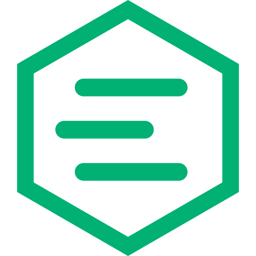

<p align="center">
  <picture>
    <source media="(prefers-color-scheme: dark)" srcset="assets/icon-dark.svg">
    <source media="(prefers-color-scheme: light)" srcset="assets/icon-light.svg">
    
  </picture>
</p>

<h1 align="center">aac-emqx-mqtt</h1>

<p align="center">Self-hosted deployment definition for EMQX, an MQTT broker with a web dashboard.</p>

<p align="center">
  <a href="https://github.com/emqx/emqx"></a>
  
  <a href="https://github.com/emqx/emqx/blob/release-58/LICENSE"></a>
</p>

## About

EMQX is an MQTT broker for connecting IoT devices and routing their messages in real time.
It supports MQTT 3.1, 3.1.1 and 5.0 over TCP, TLS, WebSocket and secure WebSocket, and ships
with a web dashboard for monitoring clients, sessions, subscriptions and rules. This
deployment runs a single EMQX node with a fixed MQTT user seeded into the built-in
authentication database.

Key features (as provided by upstream):

- MQTT 3.1, 3.1.1 and 5.0 over TCP, TLS, WebSocket and secure WebSocket
- Built-in authentication and authorization, with a built-in database for users
- Web dashboard for monitoring clients, sessions and subscriptions
- Rule engine and data integrations (as provided by upstream)
- Rate limiting for connections, messages and packets

## Upstream

- Project: <https://github.com/emqx/emqx>
- Website: <https://www.emqx.com>
- Documentation (5.8): <https://docs.emqx.com/en/emqx/v5.8/>
- Container image: `emqx/emqx:5.8.8` (Docker Hub)
- License: Apache-2.0 for the 5.8 release line; the `master` branch (5.9 and later) is licensed under the Business Source License 1.1. See the upstream `LICENSE` file for the version in use.

## Quick start (Docker Compose)

The Compose file is rendered from `service.yml` by the App-as-Code template engine. For a
manual run, the external networks used for routing must exist first:

```bash
docker network create services-secured
docker network create services-exposed
docker network create docker-default

# Provide the secrets listed under "Configuration" in .env / stack.env
docker compose up -d
```

Secrets are not stored in this repository. Provide them through the deployment pipeline
or create the `.env` and `stack.env` files yourself (see below). Do not commit them.

## Configuration

Environment variables (defaults from `service.yml`; `CHANGE_ME` must be set per deployment):

| Variable | Default | Description |
|---|---|---|
| `EMQX_NAME` | `emqx` | Cluster name |
| `EMQX_NODE_NAME` | `emqx@emqx-mqtt` | Erlang node name |
| `EMQX_NODE_COOKIE` | `CHANGE_ME` (secret) | Erlang node cookie |
| `EMQX_DASHBOARD__DEFAULT_USERNAME` | `admin` | Dashboard administrator user |
| `EMQX_DASHBOARD__DEFAULT_PASSWORD` | `CHANGE_ME` (secret) | Dashboard administrator password |
| `EMQX_MQTT_PASSWORD` | `CHANGE_ME` (secret) | Password of the fixed MQTT user `mqtt`, seeded from the bootstrap CSV. Every MQTT client using this user must use the same value. |
| `EMQX_STORAGE__SUBSCRIPTIONS` | `True` | Store subscriptions |
| `EMQX_DURABLE_SESSIONS__ENABLE` | `false` | Enable durable sessions |
| `EMQX_RATE_LIMIT__CONNECTIONS__MAX` | `100000` | Connection rate limit |
| `EMQX_RATE_LIMIT__MESSAGES__MAX` | `1000000` | Message rate limit |
| `EMQX_RATE_LIMIT__PACKETS__PER_SECOND` | `1000000` | Packet rate limit |
| `EMQX_ALLOW_ANONYMOUS` | `true` | Legacy EMQX 4.x-style flag; not read by EMQX 5.x (see note below) |
| `EMQX_ACL__ALLOW_ALL` | `true` | Legacy EMQX 4.x-style flag; not read by EMQX 5.x (see note below) |
| `EMQX_LISTENER__TCP__EXTERNAL` | `1883` | External port for MQTT over TCP |
| `EMQX_LISTENER__SSL__EXTERNAL` | `8883` | External port for MQTT over TLS |
| `EMQX_LISTENER__WS__EXTERNAL` | `8083` | External port for MQTT over WebSocket |
| `EMQX_LISTENER__WSS__EXTERNAL` | `8084` | External port for MQTT over secure WebSocket |
| `PUID` / `PGID` | `1000` | User and group ID the container runs as |
| `TZ` | `Europe/Berlin` | Time zone |

Note on listeners and authentication: the listener and authentication settings are defined
in the base configuration `emqx.conf`, which is rendered from `custom_templates/` and mounted
into the container (see Volumes). The `EMQX_LISTENER__*` and `EMQX_ALLOW_ANONYMOUS` variables
are kept from an older template and do not control the listeners in EMQX 5.x.

Ports:

| Port | Protocol | Purpose |
|---|---|---|
| `18083` | TCP | Web dashboard |
| `1883` | TCP | MQTT |
| `8883` | TCP | MQTT over TLS |
| `8083` | TCP | MQTT over WebSocket |
| `8084` | TCP | MQTT over secure WebSocket |
| `4370` | TCP | Cluster RPC |

Volumes:

| Mount | Description |
|---|---|
| `data` -> `/opt/emqx/data` | EMQX data files |
| `logs` -> `/opt/emqx/log` | EMQX log files |
| `emqx_conf` -> `/opt/emqx/etc/emqx.conf` | Base configuration (listeners, authentication, authorization), bind-mounted from the SSoT |
| `emqx_users` -> `/opt/emqx/etc/custom_emqx/emqx_bootstrap_users.csv` | Bootstrap users for the built-in database, re-seeded on every start |

## Upgrading

The data directory is tied to the EMQX major version. The mnesia format of EMQX 6.x is not
compatible with 5.8, so the data volume must be reset once when moving from a 6.x instance
to this 5.8 definition.

## Deploy with App-as-Code

1. Edit `service.yml`. It is the single source of truth for image, ports, environment,
   volumes, dependencies and per-stage overrides. Do not edit the rendered output.
2. Pushing to `main` (or a configured stage branch) runs the service pipeline, which renders
   the manifests with `aac-template-engine` and triggers the deployment.
3. Releases of this definition are published under <https://github.com/app-as-code/aac-emqx-mqtt>.

## Credits and license

EMQX is developed by EMQ Technologies and licensed as described under "Upstream" above. This
repository only contains the deployment definition for it and is not a fork of the
application. The logo is provided by the EMQX project; see [`assets/ICON_SOURCE.md`](assets/ICON_SOURCE.md)
for icon sources and licenses.
